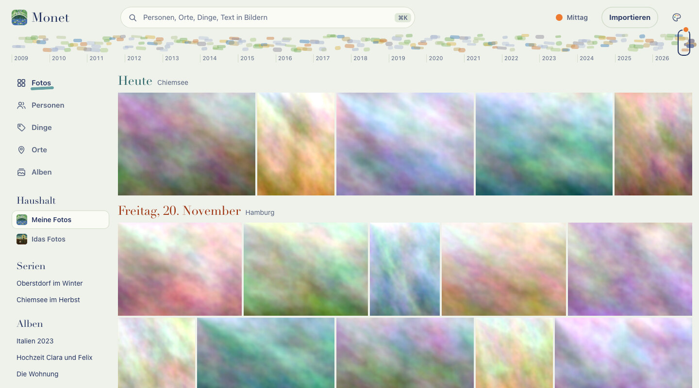
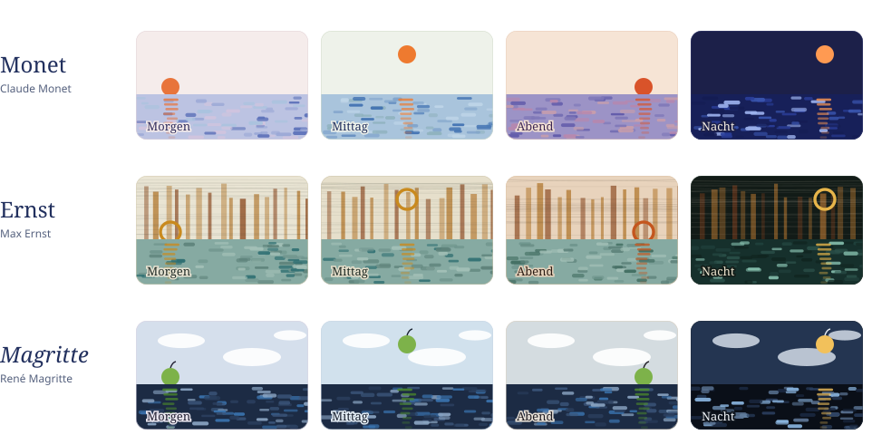

<div align="center">


# Monet

**A household's photographs, kept the way a painter keeps a garden.**

</div>

Monet painted the same haystacks some twenty-five times, because the light kept changing and the haystacks didn't. A family
photo library is the same thing: the same lake every summer, the same tree every Christmas, the same faces getting
older. Monet (the app) is built around that. It runs on a server you own, holds every original untouched, and
paints the rest.



## Series, not albums

Any place you photographed in the same season in three different years becomes a series on its own:
*Herrsching im Winter*, one picture per year, side by side. Nobody makes these by hand. They are just there one day,
the way Monet's Rouen cathedrals are.

The timeline has a brushstroke band down its edge: every month is painted in the three colours its photos actually
contain, so a summer at the sea and a November indoors look different before you scroll to them.

## Three painters, four lights

Everyone in the household picks a painter, and the whole app takes on how that painter worked, down to the
underlines and the map. Monet dabs. Ernst rubs pencil over wood and hangs a ring sun in a forest. Magritte cuts a
day sky out of a night sea. And each of them follows the clock: morning, noon, evening and night are four palettes,
so the app at 22:00 is not the app at 10:00 with the brightness turned down.



## The darkroom is your browser

Finding "Im Schnee, ohne Oma" needs a model that understands pictures and faces. Monet does not send your photos
to anyone for that, and the server is a small machine that has better things to do. So while the app is open, the
*Dunkelkammer* runs in your own browser: SigLIP 2 learns what is in each picture, YuNet and SFace find and recognise
faces, and only the numbers go back to the server. Search understands German, people's names, seasons, years and
places, and if the strictest part of your query finds nothing, it tells you what it found without it.

Shots taken within two seconds of each other fold into one, and the sharpest is on top.

## Phones and Macs

The Android app and the Mac menu bar agent do one thing: carry new photos home. The Mac also keeps a second copy of
every original, and the server knows which ones it has. A Google Takeout export imports with its dates and places
intact.

## Run your own

Monet is for people who trust each other, on a server one of them runs. There are no passwords and no mail:
everyone signs in with a passkey, and new people arrive by a link that works once.

```sh
cd app && bun install && bun run build.ts && bun server/main.ts   # prints a setup link on first start
```

1. Put it behind HTTPS (passkeys need it), listening on 127.0.0.1: a Cloudflare Tunnel, or Caddy with
   `reverse_proxy 127.0.0.1:4320`. Set `MONET_ORIGIN` to the public address once; passkeys are bound to its host name.
   The proxy must set `X-Forwarded-For` and overwrite what the client sent.
2. Set `MONET_SETUP_TOKEN` to a long random string. Opening `https://<host>/setup#<token>` makes the first account,
   an admin.
3. Invite from *Haushalt*, or `monet invite <name>` on the server. Send the link over a messenger.
4. A lost phone: an admin taps *Neuer Passkey* next to the person. A locked-out last admin runs
   `monet reset-passkeys <name>` on the server.

The contract every part builds against is [`docs/spec.md`](docs/spec.md); accounts are in
[`app/docs/accounts.md`](app/docs/accounts.md), the in-browser models in [`app/docs/ml.md`](app/docs/ml.md).
The only dependency is Svelte. Everything else is Bun, SQLite, libvips, ffmpeg and the browser.
